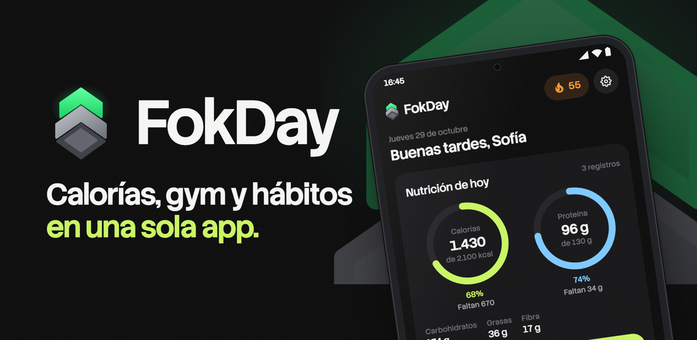
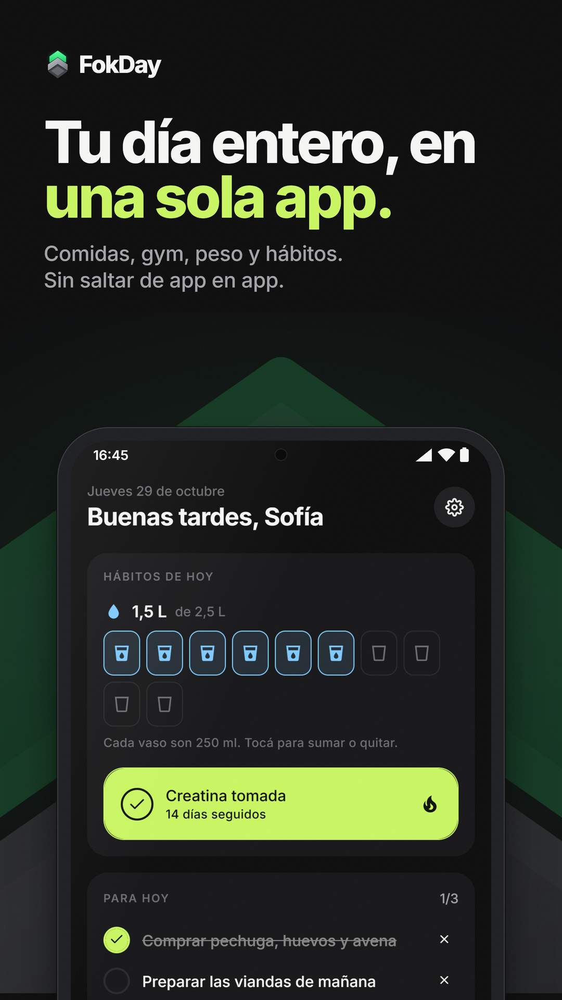
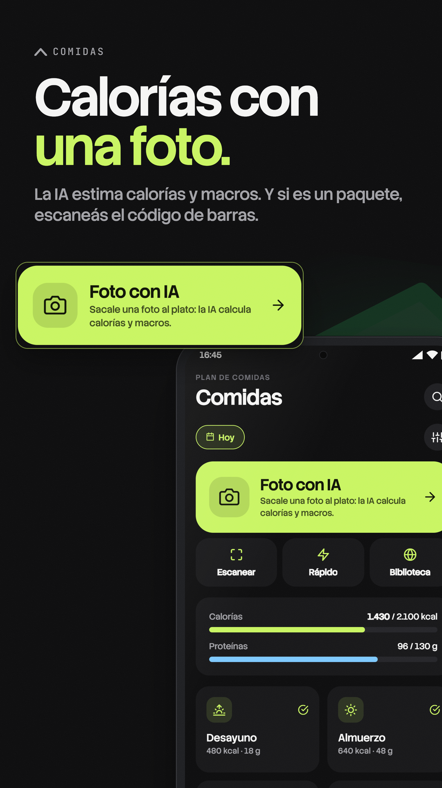
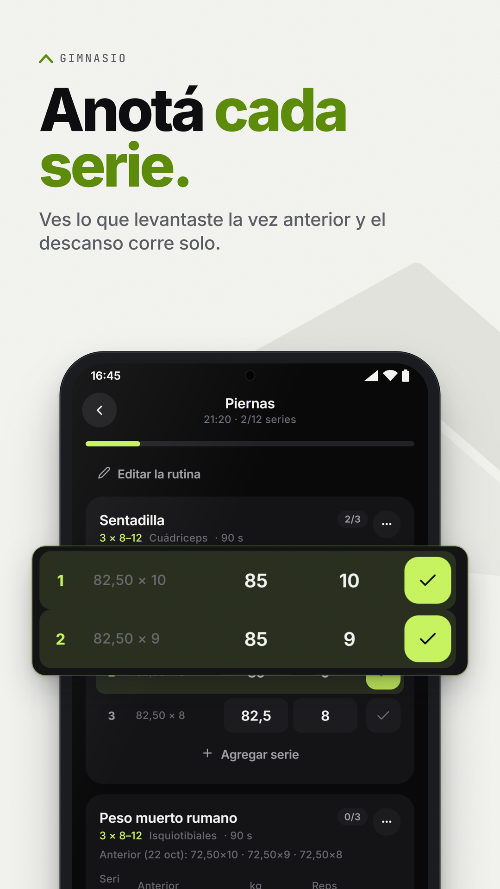
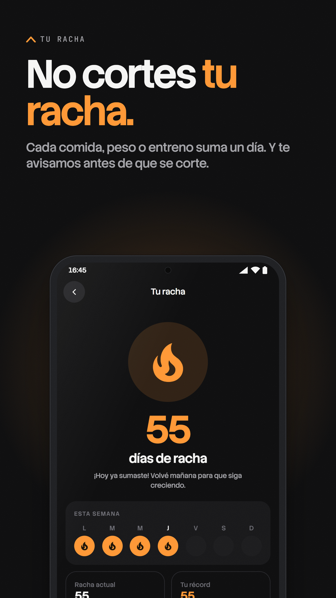
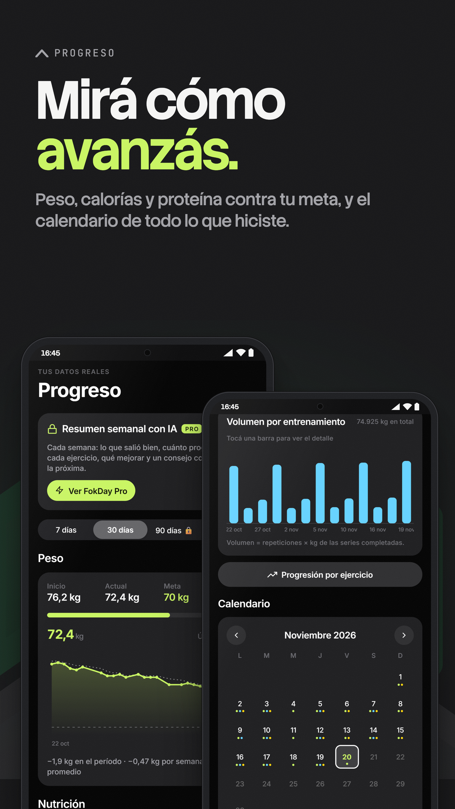
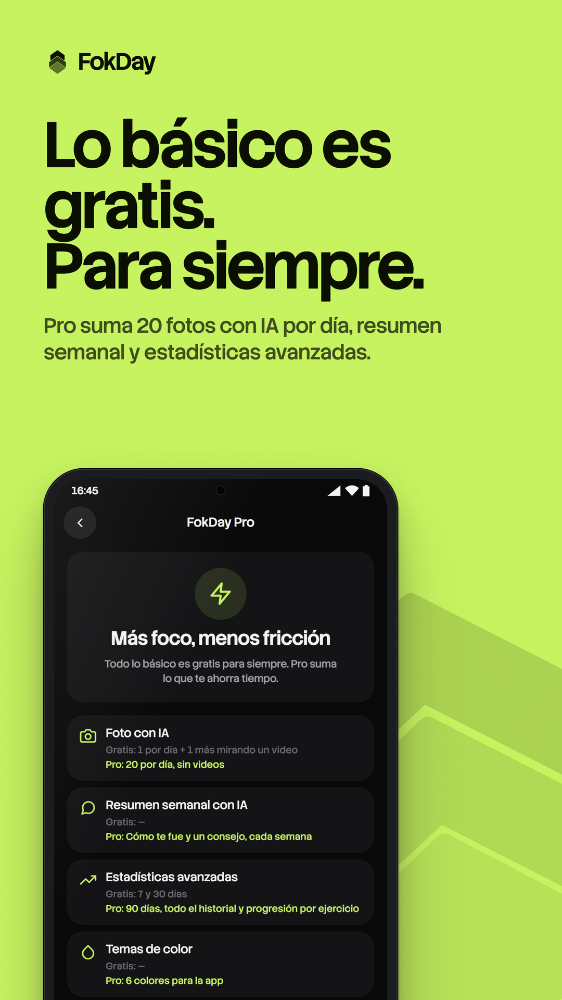

<p align="center">
  
</p>

<p align="center">
  <b>Calories from a photo, your gym routine and your daily habits, in one Android app.</b><br>
  Local-first, works offline, with optional cloud backup. The app is in Spanish (Uruguay).
</p>

<p align="center">
  
  
  
  
  
</p>

<table align="center">
  <tr>
    <td></td>
    <td></td>
    <td></td>
    <td></td>
    <td></td>
    <td></td>
  </tr>
</table>

## What it does

- **📸 Calories from a photo.** Snap your plate and the AI estimates calories, protein, carbs and fat. You can fix any value before saving.
- **🔎 Barcode scanner.** Packaged food comes from [Open Food Facts](https://world.openfoodfacts.org). You can also log by hand or repeat a meal you had before.
- **🏋️ Gym routines.** Routines by weekday, one set at a time, with what you lifted last time in view, a rest timer and 876 exercises explained in Spanish.
- **⚖️ Weight and goals.** Lose, gain or maintain, with milestones on the way and daily calorie and protein targets.
- **✅ Habits and to-dos.** Water, creatine, walks and your list for the day. Reminders only mention what is still missing.
- **🔥 Streaks.** Every meal, weigh-in or workout counts the day. Streak shields cover a missed day.
- **📊 Progress.** Weight, calories and protein against your goal, volume per workout, per-exercise progression and a calendar of everything you logged.
- **🔒 Your data stays yours.** Everything works without an account. Sign in (Google or email) only if you want automatic cloud backups.

## Meet Foki

<p>
  
  
  
  
</p>

Foki is the app's mascot. It cheers on the home screen, celebrates streaks and shows up in reminders with a face that matches the message.

## Free and Pro

|  | Free | Pro |
|---|---|---|
| Meals, workouts, routines, weight, habits, reminders | ✅ | ✅ |
| Exercise guide, barcode scanner, cloud backup, JSON/CSV export | ✅ | ✅ |
| AI food photos | Daily allowance, plus extra ones for an optional rewarded video | 20 per day, no videos |
| AI weekly summary | | ✅ |
| 90-day and all-time stats, per-exercise progression, color themes | | ✅ |
| Ads | Only if you choose to watch a video | None |

Pro is a subscription through Google Play Billing (RevenueCat). The server decides every limit, so they can change without an app update.

## Architecture

```
Android app (Expo SDK 58, React Native, TypeScript, Expo Router)
 ├─ SQLite (expo-sqlite) ← primary database, every action is saved here first
 │   meals · meal_logs · routines · sessions · sets · attendance · weight · goals · todos …
 └─ Backup and AI services (only when online)
      └─ HTTPS + Supabase session → Edge Function `momentum` → Postgres + private Storage (gzip snapshots)
                                                              ├─ Gemini (food photo, weekly summary)
                                                              ├─ Open Food Facts (barcodes)
                                                              ├─ RevenueCat (Pro check)
                                                              └─ AdMob server-side verification (rewarded videos)
```

- **Local-first.** Every screen reads and writes SQLite. Nothing waits on the network, and the app never needs the API to work.
- **Backups are full, versioned snapshots.** SQLite triggers bump a `local_revision` counter on every write. When it is ahead of the last backup and the phone is online, the app uploads a checksummed JSON snapshot. Each profile keeps its 3 newest backups plus one per day for a week.
- **No duplicates, no silent overwrites.** Retries reuse the same backup id and the server ignores ids it already has. Restoring is always a manual, confirmed action: it shows what the backup contains, warns if local changes would be lost and writes a local safety copy first.
- **Accounts are optional.** Google or email and password through Supabase Auth. The API verifies the session and finds or creates that account's profile. Sessions live in SecureStore. Only public values ship in the APK, all in `src/config.ts`.
- **The server is the authority for limits.** Daily allowances (AI photo, barcode, weekly summary) are reserved atomically in Postgres and refunded if the call fails. Limits live in `momentum_config`.
- **Dates** are stored as `YYYY-MM-DD` keys in America/Montevideo time, so a meal logged at 23:30 counts for that day, not the UTC one.

Some decisions:
- **Backend: Supabase** (Edge Function + Postgres + Storage on the free tier). Tables have RLS on with no policies and the bucket is private, so only the function's secret key reaches the data.
- **Styling: a typed design-token system** (`src/theme`) instead of NativeWind, to avoid Babel/Metro configuration risk on SDK 58.
- **Charts: custom SVG** on `react-native-svg`. Line chart, bars, rings and heatmap are small components with touch-to-inspect and no heavy chart dependency.

> The app was first called Momentum. Internal identifiers keep that name on purpose (Android package `uy.santiago.momentum`, the database file, the backup format and the Supabase function and tables), so updates install over old versions and old backups still restore.

## Project layout

```
src/app/            screens (Expo Router). (tabs)/ = Inicio, Comidas, Entrenar, Progreso
src/components/     design system (ui/), charts, calendars, Foki, feature components
src/data/           SQLite repositories (meals, workouts, attendance, weight, stats, history…)
src/domain/         pure logic (nutrition totals, streaks, weight progress, Open Food Facts, weekly summary)
src/db/             schema + migrations, seeding, database client
src/backup/         snapshot export/import, sync, background service, JSON/CSV files
src/auth/ src/billing/ src/ads/   accounts, Pro (RevenueCat), rewarded videos (AdMob)
src/notifications/  local reminders and the rest timer
supabase/           API (Edge Function `momentum`) and SQL migrations
test/               Jest tests, run against a real SQLite engine
store-assets/       Play Store images, built from real screenshots of the app
docs/               privacy policy, account deletion page, Play Store checklist, security review
```

## Development

Requirements: Node 20+ (tested with Node 24) and npm.

```bash
npm install
npm test            # 200+ tests
npm run typecheck
npx expo lint
npm run web         # quick UI preview in a browser (SQLite's web build)
npx expo start      # dev server; needs a development build on the phone, not Expo Go
```

The local database needs no setup. It is created on first launch, migrated with `PRAGMA user_version` and seeded once with common starter meals and neutral defaults.

To run native code on a phone: `npx eas-cli@latest build -p android --profile development`, install that APK, then `npx expo start`.

## Backend (Supabase)

1. Create a Supabase project and run `supabase/migrations/*.sql` (SQL Editor or `supabase db push`).
2. Deploy the function: `supabase functions deploy momentum --no-verify-jwt` (it verifies the session itself).
3. Add the secrets in Supabase → Edge Functions → Secrets: `GEMINI_API_KEY` (food photo and weekly summary), and `REVENUECAT_SECRET_KEY` to check Pro.
4. Put the project URL and publishable key in `src/config.ts` and build again.

Endpoints live under `/api/`: `GET status`, `GET|POST backups`, `GET backups/latest|<id>`, `POST food/analyze`, `GET food/barcode/<code>`, `GET|POST food/library`, `DELETE food/library/<id>`, `POST ai/weekly-summary`, `POST profiles/link`, `DELETE profiles/me` and `GET ads/reward` (AdMob callback). Everything except the AdMob callback needs `Authorization: Bearer <Supabase session>`.

Free-tier notes: Supabase Free gives 500 MB of database, 1 GB of storage and 500,000 function calls a month, and pauses a project after a week without activity. Snapshots are gzip-compressed and the API rejects any over 4.4 MB, which is years of data away.

## Build and release

```bash
npx eas-cli@latest build -p android --profile preview      # APK to install directly
npx eas-cli@latest build -p android --profile production   # AAB for Google Play (bumps versionCode)
npx eas-cli@latest submit -p android --profile production  # to the closed testing track
```

The Play Store checklist (keys, forms, closed testing, store listing) is in [docs/play-store.md](docs/play-store.md).

**Updating without losing data**
- Install new builds over the existing app. Uninstalling deletes the local database.
- Builds must be signed with the same key. EAS keeps the keystore.
- Schema changes are new entries in `src/db/schema.ts → MIGRATIONS`. A released migration is never edited. Each one runs once inside a transaction, and the app refuses to open a database written by a newer version.

**On a new phone:** sign in with the same account and the app offers to restore the latest cloud backup. Without an account, use **Ajustes → Datos y respaldo → Importar respaldo (JSON)** with a file you exported.

## Tests

`npm test` runs Jest in Node against a real SQLite engine (`node:sqlite`) with the same SQL as the app. They cover:
- nutrition totals, portions and goals;
- weight progress and streaks;
- workouts, attendance and cancelling a workout;
- migrations and rollback;
- backup and restore, including tampered and newer files;
- the API: accounts, limits, rewarded-video signatures and account deletion;
- Open Food Facts parsing, the weekly summary, reminders and onboarding.

## Privacy and security

- [Privacy policy](https://fokday.vercel.app/privacidad.html) · [Delete your account](https://fokday.vercel.app/eliminar-cuenta.html)
- Security review and remaining risks: [docs/seguridad.md](docs/seguridad.md)
- Contact: fokday.app@gmail.com

## License

The code is released under the [MIT License](LICENSE).

The FokDay name, the logo and the Foki mascot are not covered by that license. Forks need their own name and artwork, and their own Supabase project, since this one only answers to the official app.
